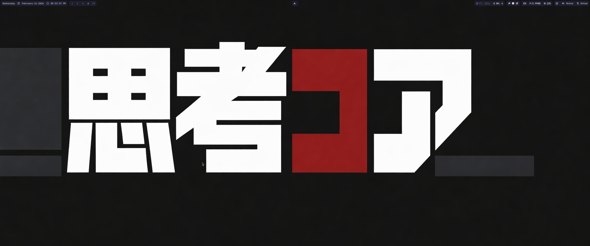
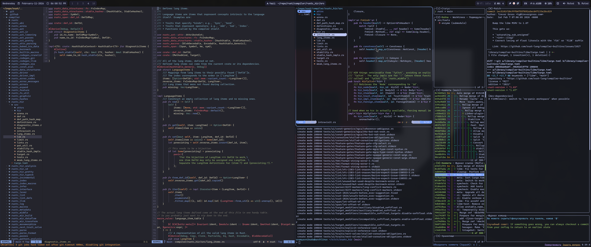

# .config

My configs: Hyprland (Lua), Quickshell (QML bar, launcher, notifications), kitty, nvim, yazi, fish/zsh.

Screenshots:

## Hyprland Hotkeys

Main modifier — **SUPER** (Windows key).

### General

| Keys | Action |
|---|---|
| `SUPER + Enter` | Open terminal (kitty) |
| `SUPER + Q` | Close active window |
| `SUPER + R` | Application launcher (Quickshell) |
| `SUPER + E` | File manager (Dolphin) |
| `SUPER + L` | Lock screen (hyprlock) |
| `SUPER + M` | Exit Hyprland |
| `Alt + Shift` | Switch keyboard layout (us/ru) |

### Windows

| Keys | Action |
|---|---|
| `SUPER + arrows` | Move focus |
| `SUPER + SHIFT + arrows` | Swap window with the neighbor |
| `SUPER + V` | Toggle floating mode |
| `SUPER + P` | Toggle pseudo-tiling |
| `SUPER + J` | dwindle: change split direction / master: swap with master |
| `SUPER + LMB` (drag) | Drag window with the mouse |
| `SUPER + RMB` (drag) | Resize window with the mouse |

### Workspaces (10 total: 1–9 and 0 = 10th)

| Keys | Action |
|---|---|
| `SUPER + 1..9, 0` | Switch to workspace |
| `SUPER + SHIFT + 1..9, 0` | Move window to workspace |
| `SUPER + CTRL + ←/→` | Cycle through all workspaces (wraps around) |
| `SUPER + mouse scroll` | Cycle through workspaces |
| `SUPER + S` | Show/hide special workspace (scratchpad) |
| `SUPER + SHIFT + S` | Move window to scratchpad |

### Window layouts

| Keys | Action |
|---|---|
| `SUPER + ALT + L` | Toggle layout: dwindle ↔ master |
| `SUPER + ALT + ←/→` | Master area width (in master layout) |

dwindle — flexible columns/spiral (default).
master — one big window on the left, the rest stacked on the right.

### Screenshots and clipboard

| Keys | Action |
|---|---|
| `Print` | Screenshot selected area → clipboard |
| `SHIFT + Print` | Screenshot entire screen → clipboard |
| `SUPER + SHIFT + V` | Clipboard history (cliphist + rofi) |

### Multimedia

| Keys | Action |
|---|---|
| `XF86AudioRaise/LowerVolume` | Volume ±5% |
| `XF86AudioMute` | Mute |
| `XF86AudioMicMute` | Mute microphone |
| `XF86MonBrightnessUp/Down` | Screen brightness |
| `XF86AudioNext/Prev/Play/Pause` | Media player control (playerctl) |

Volume can also be adjusted by scrolling over the volume icon in the bar; clicking it opens the mixer (pavucontrol).
